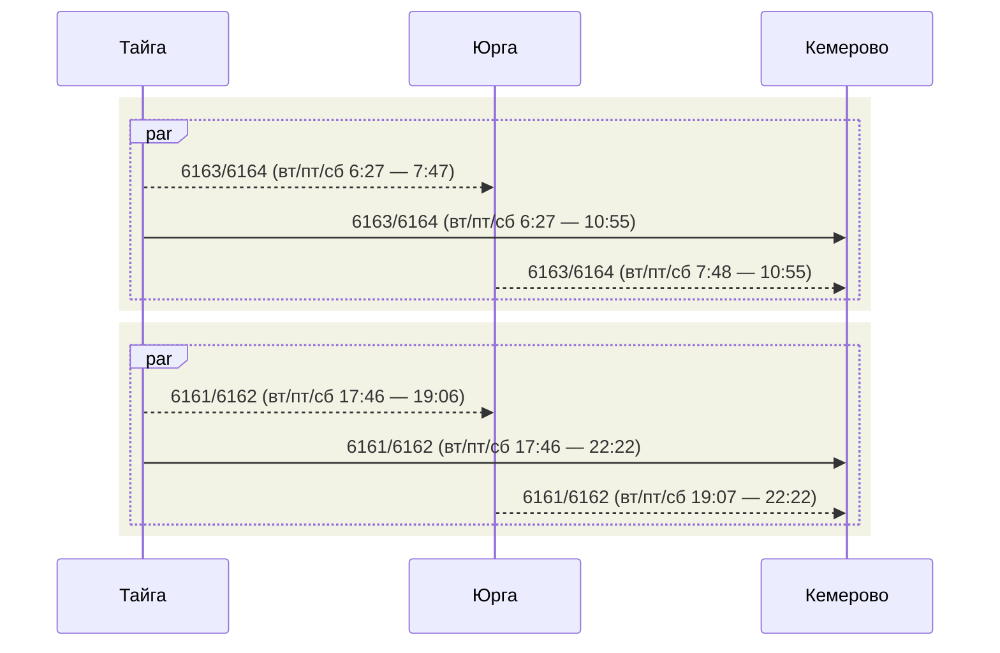
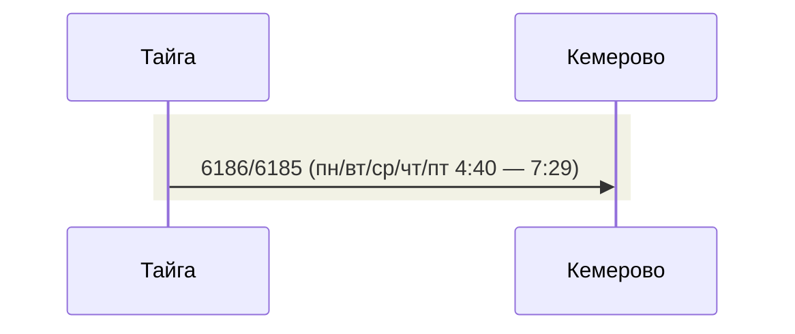
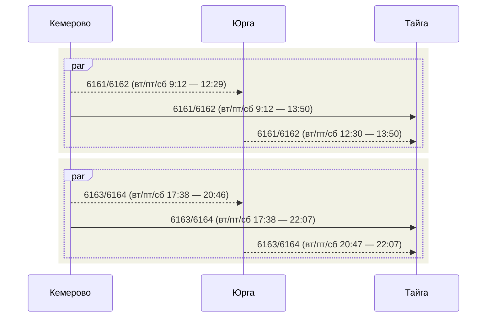
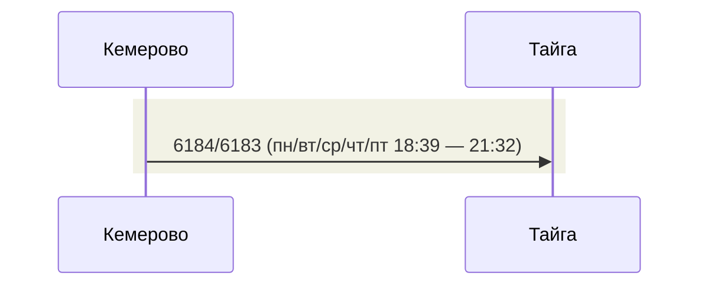

# Расписание

- 6161/6162 и 6163/6164 осуществляют полный круг Тайга-Юрга-Кемерово-Барзас-Тайга одновременно выходя в разные стороны утром и вечером

## Тайга - Юрга - Кемерово

## Тайга - Барзас - Кемерово

## Кемерово - Юрга - Тайга

## Кемерово - Барзас - Тайга

