# Карта

```mermaid
graph LR
    classDef transsib stroke:#1d4ed8,stroke-width:6px;
    classDef yuzhsib stroke:#d97706,stroke-width:3px;

    Омск omsk_novosibirsk@--> Новосибирск

    Юрга(("Юрга"))

    Новосибирск novosibirsk_yurga@--> Юрга

    Юрга <--> Кемерово

    Тайга(("Тайга"))

    Юрга yurga_taiga@--> Тайга

    Тайга <--- Барзаc{{ Барзас }} ---> Кемерово
    Тайга <--> Томск
    Тайга taiga_krasnoyarsk@-.-> Красноярск

    Артышта(("Артышта"))

    Новосибирск --"Кузбасский ход"--> Артышта

    Алтайская(("Алтайская (Новоалтайск)"))

    Новосибирск -->|"Алтайский ход"| Алтайская

    Алтайская altaiskaya_artishta@--> Артышта
    Алтайская <--> Барнаул
    Алтайская <--> Бийск

    Артышта artishta_novokuznetsk@--> Новокузнецк
    Новокузнецк novokuznetsk_abakan@--> Абакан

    Уяр(("Уяр"))
    Саянская(("Саянская (Саянский)"))

    Саянская <--> Уяр

    Красноярск krasnoyarsk_uyar@--> Уяр
    Абакан abakan_sayanskaya@-->|"Трасса мужества"| Саянская

    Тайшет(("Тайшет"))

    Уяр uyar_tayshet@--> Тайшет
    Саянская sayanskaya_tayshet@-.->|"Трасса мужества"| Тайшет

    Тайшет tayshet_irkutsk@--> Иркутск

    Слюдянка(("Слюдянка"))
    ПортБайкал["Порт Байкал"]

    Иркутск irkutsk_sludyanka@--> Слюдянка

    Слюдянка <-->|"Кругобайкальская железная дорога"| ПортБайкал
    Слюдянка sludyanka_ulanude@-.-> Улан-Удэ

    Улан-Удэ ulanude_chita@--> Чита

    Белогорск(("Белогорск"))

    Чита chita_belogorsk@-.-> Белогорск

    Белогорск belogorsk_birobidzhan@-.-> Биробиджан
    Белогорск <-.-> Благовещенск

    Биробиджан birobidzhan_habarovsk@--> Хабаровск

    Хабаровск habarovsk_ussuriysk@--> Уссурийск

    Угольная(("Угольная (Трудовое)"))

    Уссурийск ussuriysk_ugolnaya@--> Угольная

    Угольная <--> Находка
    Угольная ugolnaya_vladivostok@--> Владивосток

    class omsk_novosibirsk,novosibirsk_yurga,yurga_taiga,taiga_krasnoyarsk,krasnoyarsk_uyar,uyar_tayshet,tayshet_irkutsk,irkutsk_sludyanka,sludyanka_ulanude,ulanude_chita,chita_belogorsk,belogorsk_birobidzhan,birobidzhan_habarovsk,habarovsk_ussuriysk,ussuriysk_ugolnaya,ugolnaya_vladivostok transsib
    class altaiskaya_artishta,artishta_novokuznetsk,novokuznetsk_abakan,abakan_sayanskaya,sayanskaya_tayshet yuzhsib
```

# Расписание

## Омск - Новосибирск

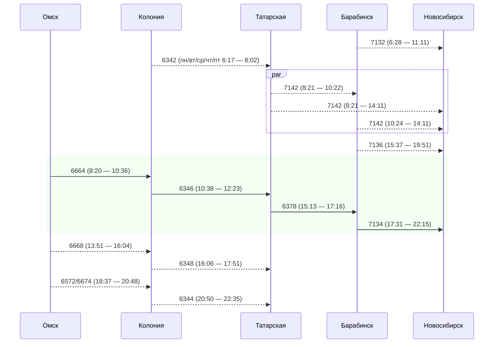

## Новосибирск - Юрга - Тайга

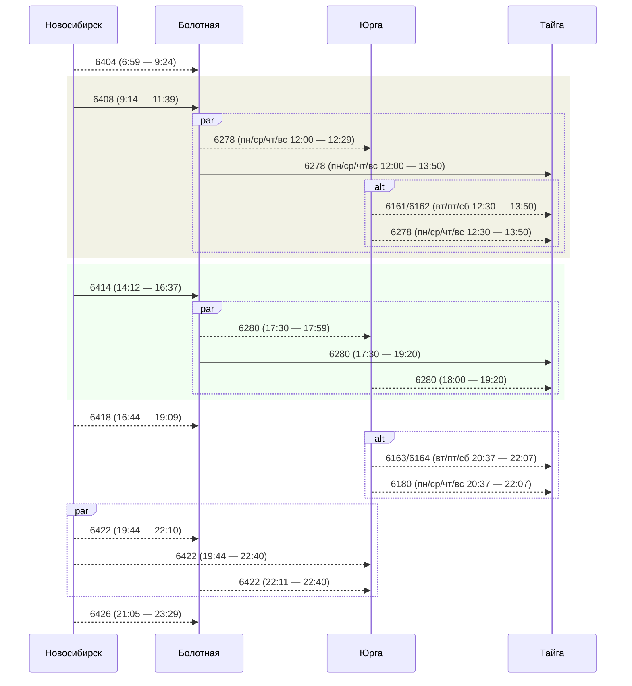

## [Тайга - Кемерово](Branches/Kemerovo.md)

## [Тайга - Томск](Branches/Tomsk.md)

## Тайга - Красноярск

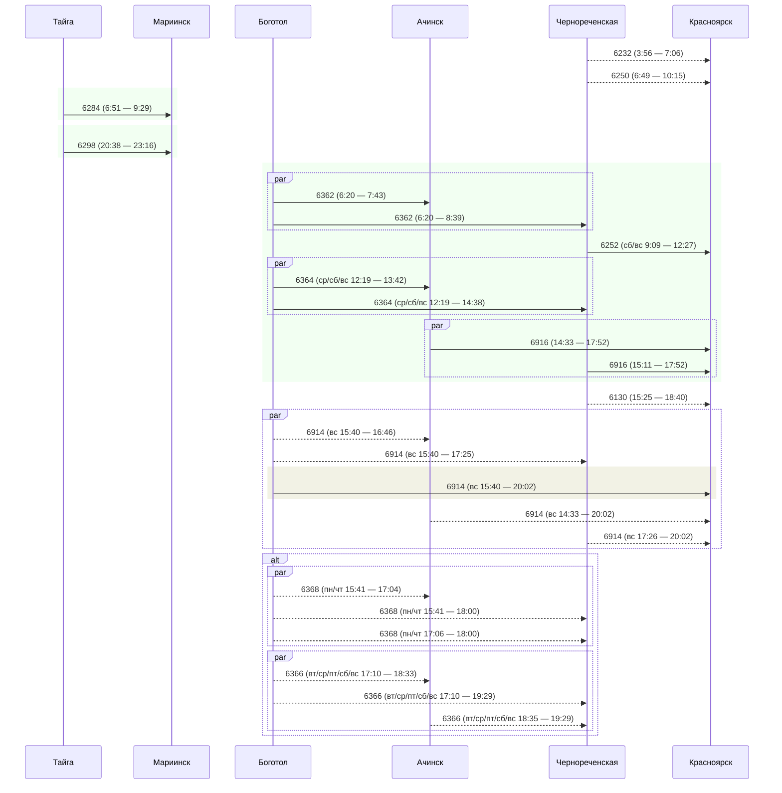

## Новосибирск - Артышта

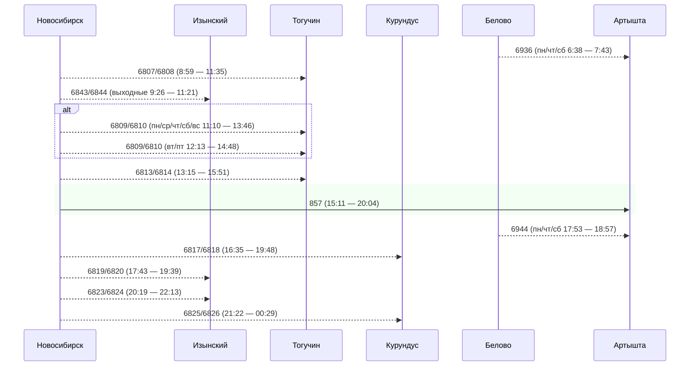

## Новосибирск - Алтайская

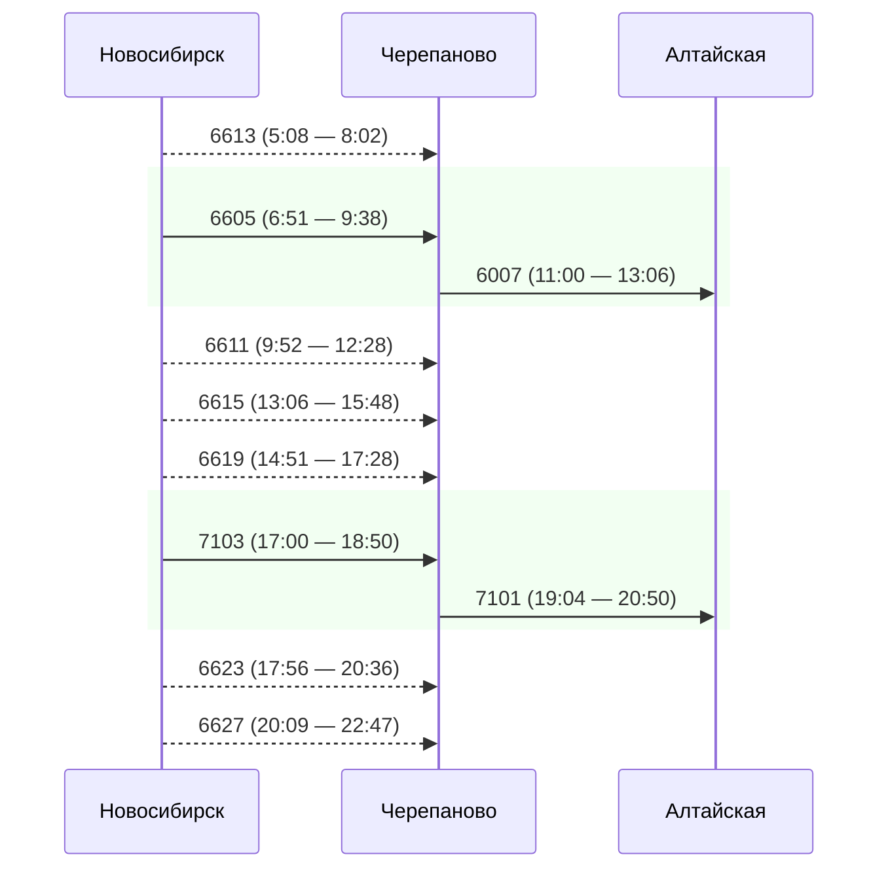

## Алтайская - Артышта

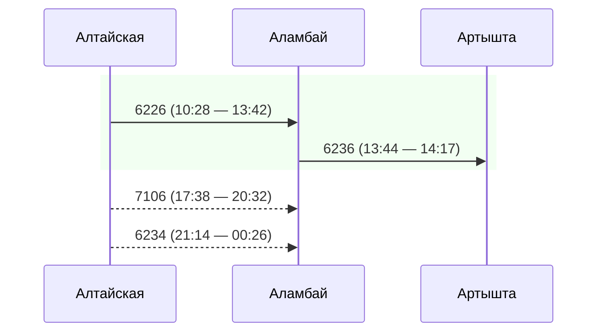

## Артышта - Новокузнецк

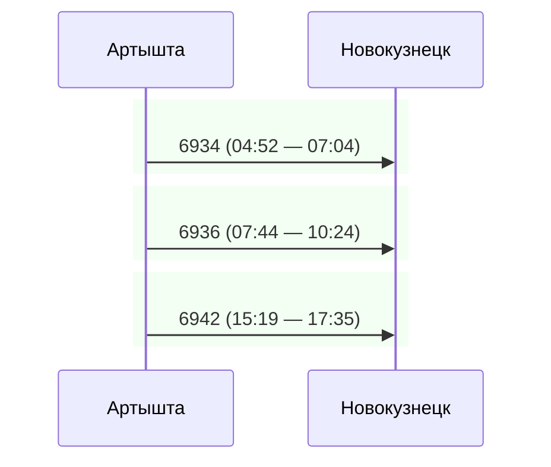

## Новокузнецк - Абакан

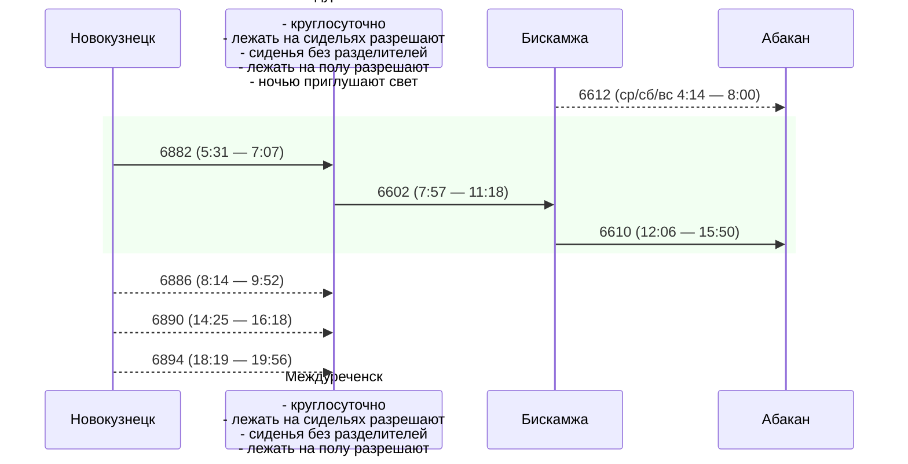

## Красноярск - Уяр - Тайшет

TODO: Add "participant Уяр"

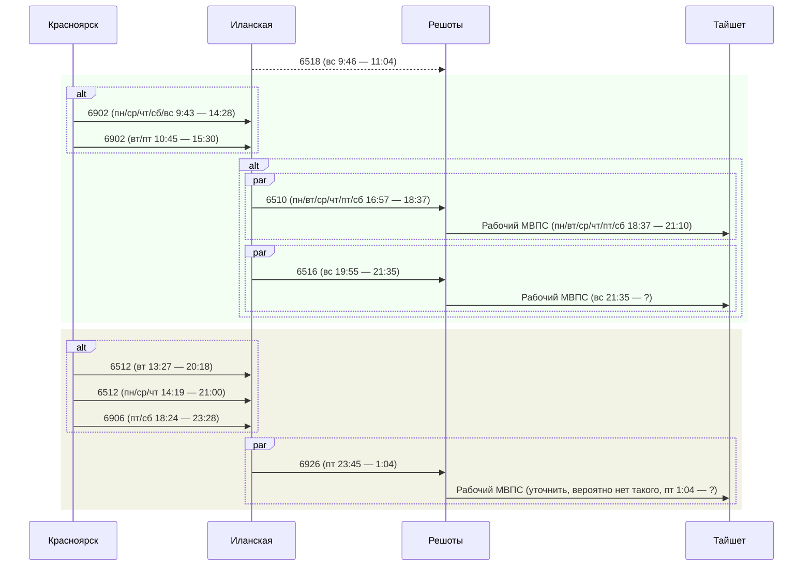

## Абакан - Саянская - Тайшет

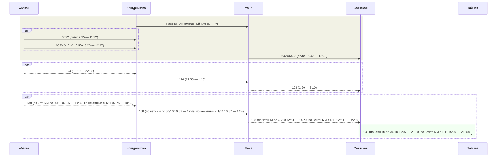

## [Саянская - Уяр](Branches/SayanskayaUyar.md)

## [Уяр - Саянская](Branches/SayanskayaUyar.md)

## Тайшет - Иркутск

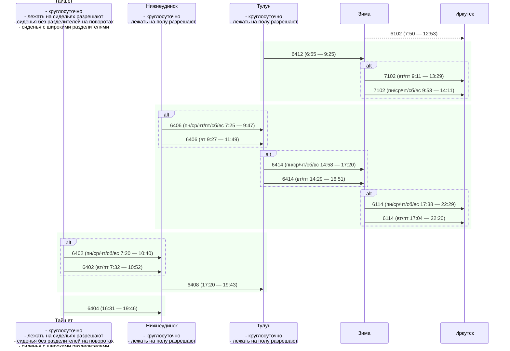

## Иркутск - Слюдянка - Улан-Удэ

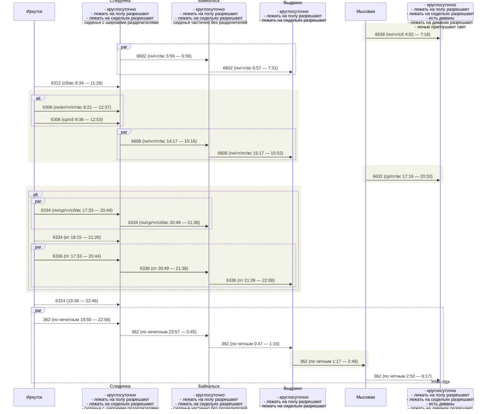

## [Слюдянка - Порт Байкал](Branches/PortBaikal.md)

## Улан-Удэ - Чита

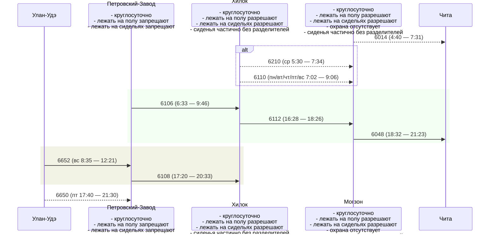

## Чита - Белогорск

Бог создал Крым и Сочи, а черт - Сковородино и Могочи

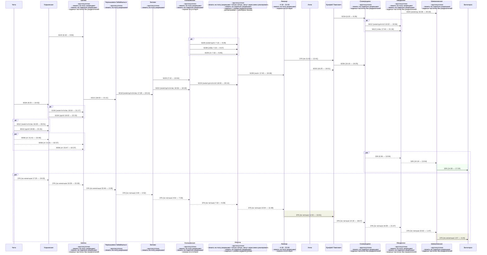

## [Белогорск - Благовещенск](Branches/Blagoveshchensk.md)

## Белогорск - Биробиджан

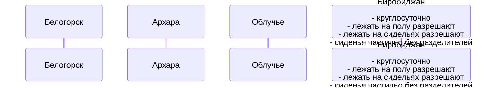

## Биробиджан - Хабаровск

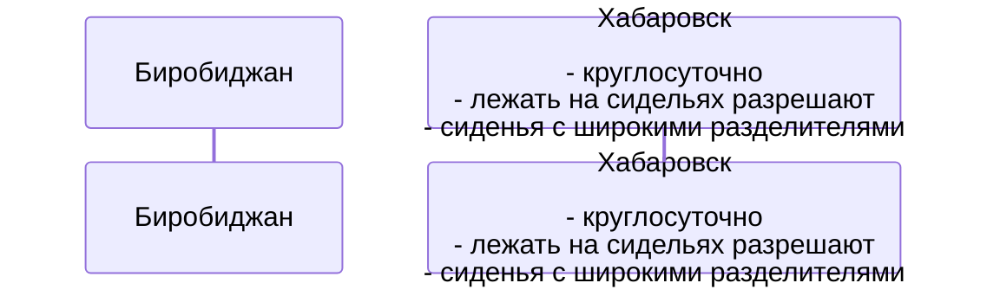

## Хабаровск - Уссурийск - Угольная - Владивосток

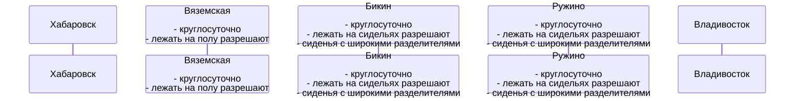

## [Угольная - Находка](Branches/Nahodka.md)
